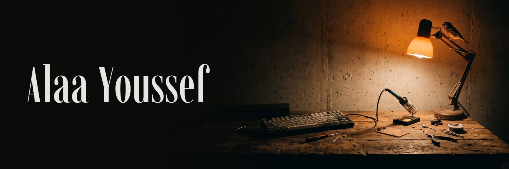

> Automating my job until it disappears, on purpose. The birds don't have a manager, and they seem fine.

Computer engineer in Dubai. I build systems that outlive the org chart, ship tools nobody asked me to document, and lose to my Roomba at spatial awareness on a daily basis.

## The studio

In 2026 I founded [LadonAl Labz](https://ladonal.com/en), an engineering studio in Dubai. We design and build websites, stores and software for Gulf companies, in Arabic and English, then stay on to run them.

The name is Ladon plus Al, and the Al is mine. AL, not AI.

[ladonal.com](https://ladonal.com/en) · [العربية](https://ladonal.com/ar) · [The work](https://ladonal.com/en/work)

## On the record

Live builds, each on its own domain.

| Build | What it is | Made with |
|---|---|---|
| [Mortar & Kettle](https://www.mortarandkettle.com) | My own corner of the web: food science and home cooking, as a content library in Arabic and English. | Next.js, next-intl, Tailwind CSS |
| [Trashy T-Shirts](https://www.trashytshirts.com) | Concept storefront with an image pipeline. | Next.js, shadcn/ui, fal.ai |
| [Arsu Tours](https://arsu.tours) | Concept travel site covering ten regions. | Next.js, TypeScript, Tailwind CSS |
| [fatima.coach](https://www.fatima.coach) | Coaching site in Arabic and English. | Next.js, Keystatic |

## Open source

[`odoo-oss-addons`](https://github.com/LadonAl/odoo-oss-addons): free addons for Odoo 19, made for businesses that work in the UAE and the Gulf.

| Addon | What it does |
|---|---|
| [`payment_ziina`](https://github.com/LadonAl/odoo-oss-addons/tree/19.0/payment_ziina) | Takes payments through Ziina by card, Apple Pay or Google Pay, and sends refunds from Odoo. |
| [`currency_rate_update_cbuae`](https://github.com/LadonAl/odoo-oss-addons/tree/19.0/currency_rate_update_cbuae) | Daily exchange rates from the Central Bank of the UAE. |
| [`currency_symbol_sar_aed`](https://github.com/LadonAl/odoo-oss-addons/tree/19.0/currency_symbol_sar_aed) | The official Saudi riyal and UAE dirham signs, with a font that can draw them. |

## Also on the bench

- Years deep in Odoo: custom modules, portal forms, website builder XML, Odoo.sh deployments. I speak fluent ERP and passive-aggressive commit messages.
- Image-to-3D pipelines, and local LLMs on hardware I swore I'd recycle.
- FPGAs and reconfigurable computing.
- Automating anything that dares to be repetitive.

## Say hello

Write to me through [ladonal.com/contact](https://ladonal.com/en/contact). I answer within one business day.

---

`0x414341` says relax. Code is a commons, I just keep finding it behind paywalls.
